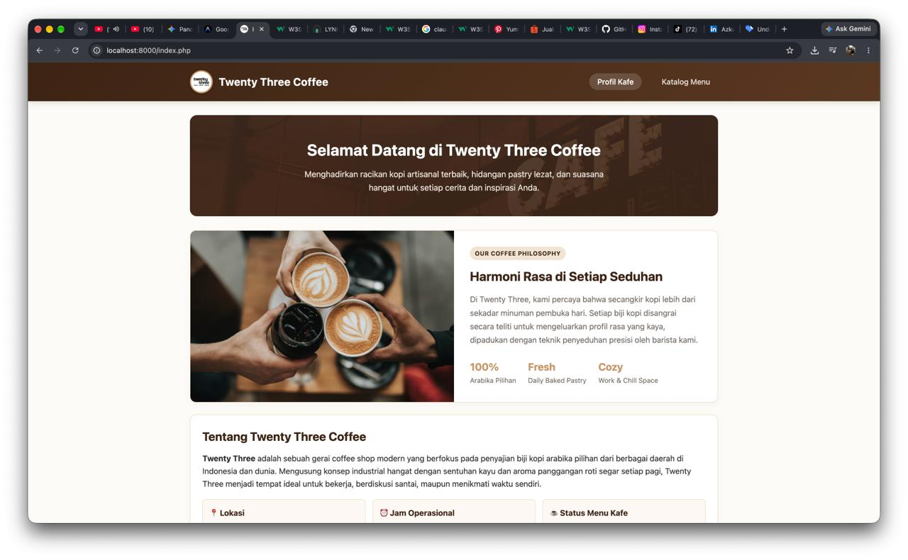
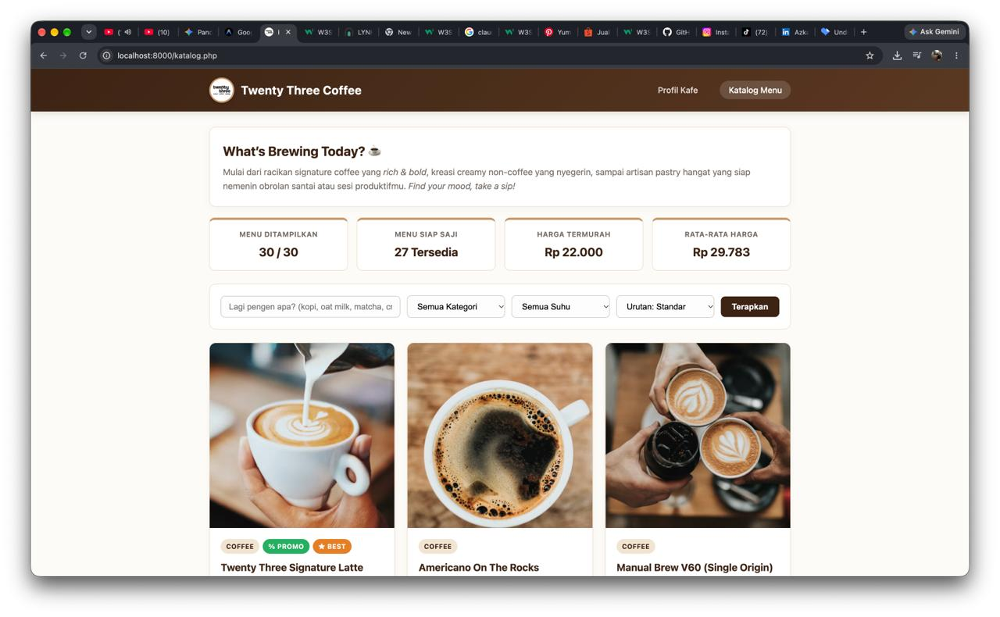

# Twenty Three Coffee - Katalog Dinamis

## 1. Identitas
- **Nama:** Azka Kurnia Akbar
- **NIM:** 025A00200012
- **Kelas:** A2 - 3A
- **Fakultas:** Teknik
- **Program Studi:** S1 Informatika
- **Mata Kuliah:** Pemrograman Web
- **Universitas: ** Tiga Serangkai University

## 2. Deskripsi Tema
Website profil dan katalog dinamis untuk "Twenty Three Coffee". Menyajikan informasi tempat nongkrong andalan mahasiswa di Surakarta beserta daftar menu, harga, status ketersediaan, dan promo yang dikelola secara dinamis menggunakan struktur Array multidimensi pada PHP native tanpa database dan framework.

## 3. Cara Menjalankan
1. *Clone* atau unduh repositori proyek ini.
2. Pindahkan folder proyek ke dalam direktori *server* lokal (misalnya `htdocs` untuk XAMPP/MAMP).
   - Atau langsung jalankan PHP Built-in Server di terminal:
     ```bash
     php -S localhost:8000
     ```
3. Buka *browser* dan akses URL:
   - `http://localhost:8000/index.php` (Profil Kafe)
   - `http://localhost:8000/katalog.php` (Katalog Menu Dinamis)

## 4. Daftar Fitur dan Logika
- **Navigasi Halaman:** Ditangani oleh elemen semantik `<nav>` di `index.php` dan `katalog.php`.
- **Render Menu Dinamis:** Menggunakan perulangan `foreach` pada file `katalog.php` dan `index.php`.
- **Status Ketersediaan (Habis/Tersedia):** Menggunakan percabangan `if` di file `katalog.php` yang mengubah *class* kartu dan menampilkan *badge* merah "Habis".
- **Status Promo (% Promo):** Menggunakan percabangan `if` untuk menampilkan *badge* hijau dan membedakan warna harga menu.
- **Opsi Varian Suhu (Hot / Ice):** Ditampilkan dengan *pill badge* khas kedai kopi pada menu minuman, serta dapat disaring melalui filter suhu yang ditangani oleh fungsi `filterSuhu()`.
- **Pencarian & Filter Kategori:** Fitur pencarian kata kunci dan penyaringan kategori yang ditangani oleh fungsi `cariMenu()` dan `filterKategori()`.
- **Pengurutan Data (Sorting):** Mengurutkan data (termurah, termahal, A-Z) menggunakan fungsi `urutkanMenu()`.
- **Format Harga Rupiah:** Menggunakan *custom function* `formatRupiah(int $angka): string` dari `functions.php`.
- **Keamanan Output HTML:** Menggunakan *custom function* `e(string $nilai): string` dengan `htmlspecialchars()` untuk mencegah XSS.

## 5. Fungsi Array Bawaan yang Dipakai
- `count()`: Untuk menghitung total keseluruhan menu (`hitungTotalMenu`) dan menu yang tersedia (`hitungMenuTersedia`).
- `array_filter()`: Untuk memfilter menu berdasarkan kategori, pencarian kata kunci, menu best seller, dan menu yang tersedia.
- `usort()`: Untuk melakukan pengurutan kustom (*custom sort*) pada array multidimensi dengan ekspresi `match` dan operator spaceship `<=>`.
- `array_column()`: Untuk mengambil satu kolom spesifik (seperti daftar `harga` atau `kategori`) dari array multidimensi.
- `array_unique()`: Untuk menyaring kategori unik agar tidak ada duplikasi pada pilihan dropdown filter.
- `array_values()`: Untuk mereset ulang indeks array setelah proses filtering atau deduplikasi kategori.
- `array_sum()`: Untuk menjumlahkan seluruh nilai harga menu dalam perhitungan rata-rata harga di fungsi `hitungStatistikMenu()`.
- `in_array()`: Untuk memeriksa apakah suatu menu minuman memiliki opsi varian suhu tertentu (`Hot` atau `Ice`) pada fungsi `filterSuhu()` dan saat merender *badge* varian.

## 6. Tangkapan Layar (Screenshots)



## 7. Referensi dan Penggunaan AI
- **Bantuan AI (Gemini):** Digunakan untuk merumuskan kerangka arsitektur file, template data array awal, dan panduan kode semantik. Seluruh kode telah saya validasi, sesuaikan, dan uji ulang agar sesuai dengan logika saya.
- **Dokumentasi Resmi PHP:** [https://www.php.net/manual/en/book.array.php](https://www.php.net/manual/en/book.array.php) (Dokumentasi fungsi array dan strict typing).
- **Panduan Semantik MDN Web Docs:** [https://developer.mozilla.org/en-US/docs/Glossary/Semantics](https://developer.mozilla.org/en-US/docs/Glossary/Semantics) (Struktur semantik HTML5).
